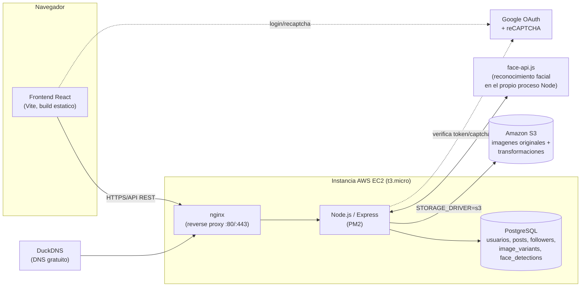
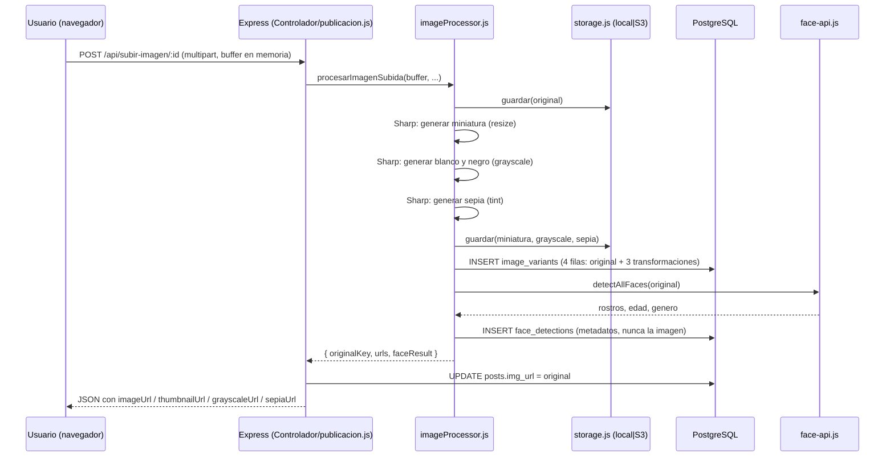

# Documentación del desarrollador — Arquitectura

Proyecto Final de Desarrollo Web (UMG) — Red social de fotografías tipo Instagram.

## 1. Visión general

La aplicación es un backend **Node.js / Express** con un frontend en **ReactJS**
(Vite + React Router, carpeta `frontend/`), una base de datos
**relacional PostgreSQL** y almacenamiento de imágenes desacoplado (**disco local en
desarrollo / Amazon S3 en producción**) a través de una capa de abstracción propia.



## 2. Capas del backend

```
index.js                 -> arranque de Express, conexion a BD, servido estatico
rutas/rutas.js            -> define todos los endpoints REST
Controlador/*.js           -> logica de negocio por recurso (user, publicacion, follow, imagen)
modelo/*.js                -> modelos Sequelize (PostgreSQL) + asociaciones (modelo/index.js)
servicios/
  jwt.js                   -> firma/verifica tokens de sesion
  storage.js                -> abstraccion de almacenamiento (local disco <-> S3)
  imageProcessor.js          -> pipeline de transformaciones automaticas + reconocimiento facial
middlewares/
  auth.js                    -> valida el JWT en rutas protegidas
  auditoria.js               -> registra cada transaccion en la tabla audit_log
  limites.js                 -> limite de intentos de login/registro (rate limiting)
database/
  conexion.js               -> conexion Sequelize + sync de modelos
  schema.sql                 -> esquema SQL de referencia (documentacion/manual)
```

## 3. Flujo de subida de una fotografía (lo más importante del proyecto)



Puntos clave que exige el enunciado y cómo se cumplen:

- **3 transformaciones automáticas al subir la imagen**: miniatura (reducción de
  escala), blanco y negro y sepia — generadas con **Sharp** sin intervención del
  usuario, en `servicios/imageProcessor.js`.
- **Reconocimiento facial al subir**: `face-api.js` corre automáticamente sobre la
  foto original (edad, género, cantidad de rostros) en el mismo flujo.
- **Las imágenes nunca se guardan en la base de datos**: solo se guarda la
  referencia (`storage_key`, tabla `image_variants`) y PostgreSQL resuelve la URL
  pública bajo demanda (`servicios/storage.js#urlPublica`).
- **Algoritmo de miniaturas**: todo el feed/listado usa `thumbnailUrl` (imagen
  reducida), mientras que la vista de detalle usa `imageUrl` (resolución completa)
  junto a las 3 transformaciones.
- Además de las 3 transformaciones obligatorias, se conserva (como función extra)
  un editor manual con **9 filtros adicionales** (invertir, desenfoque, brillo,
  contraste, cálido, frío, psicodélico...) que el usuario aplica bajo demanda sobre
  su propia foto/avatar (`Controlador/imagen.js`), y un botón de "Analizar rostro"
  para repetir el análisis facial manualmente.

## 4. Almacenamiento de imágenes (local vs S3)

`servicios/storage.js` expone una interfaz única (`guardar`, `leer`, `eliminar`,
`urlPublica`) que internamente decide, según la variable de entorno
`STORAGE_DRIVER`:

| STORAGE_DRIVER | Dónde vive el archivo | Para qué se usa |
|---|---|---|
| `local` (por defecto) | `./imagenes/<usuarios\|post>/...` en disco | Desarrollo sin cuenta de AWS |
| `s3` | Bucket de Amazon S3 (`AWS_S3_BUCKET`) | Despliegue en producción (requisito del proyecto) |

Ningún controlador llama a `fs` o al SDK de AWS directamente: todos pasan por esta
capa, así que cambiar de un entorno a otro es solo cuestión de variables de entorno
(`.env`), sin tocar código.

## 5. Decisiones de diseño y alcance

- **Base de datos relacional (PostgreSQL + Sequelize)**: el proyecto original usaba
  MongoDB; se migró completamente a PostgreSQL para cumplir el requisito explícito
  de "base de datos relacional" para cuentas de usuario y ubicación de imágenes
  (ver `docs/ESQUEMA_BD.md`).
- **Frontend en ReactJS**: el enunciado pide integrar Google Login y reCAPTCHA con
  ReactJS. El frontend (`frontend/`) está hecho con React 18, Vite y React Router;
  Google Login y reCAPTCHA v2 son componentes React (`GoogleButton.jsx`,
  `Recaptcha.jsx`). Para producción se compila con `npm run build` y nginx sirve la
  carpeta `frontend/dist` como sitio estático. La versión anterior del frontend
  (HTML + JavaScript) se eliminó del proyecto.
- **Amazon Rekognition**: no implementado (es el punto "opcional avanzado" del
  enunciado). El reconocimiento facial se resuelve con `face-api.js`, que sí es un
  requisito obligatorio.
- **Seguridad de la API**: `helmet` (cabeceras HTTP), límite de intentos en login y
  registro (`express-rate-limit`), validación de entradas con `validator`, CORS limitado al
  dominio en producción y arranque obligatorio con `JWT_SECRET`. Cada transacción queda
  en la tabla `audit_log` (ver `docs/AUDITORIA_TRANSACCIONES.md`).
- **Autenticación**: JWT propio (`servicios/jwt.js`) + bcrypt con sal única por
  usuario (`bcrypt.hash(password, 10)` genera y embebe una sal distinta en cada
  llamada) + Google OAuth2 + reCAPTCHA v2 (en login y registro).
