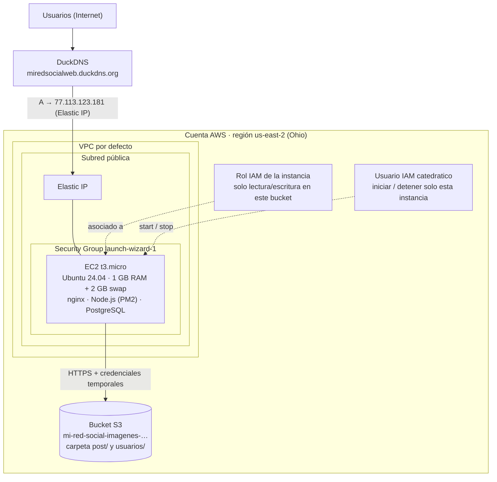
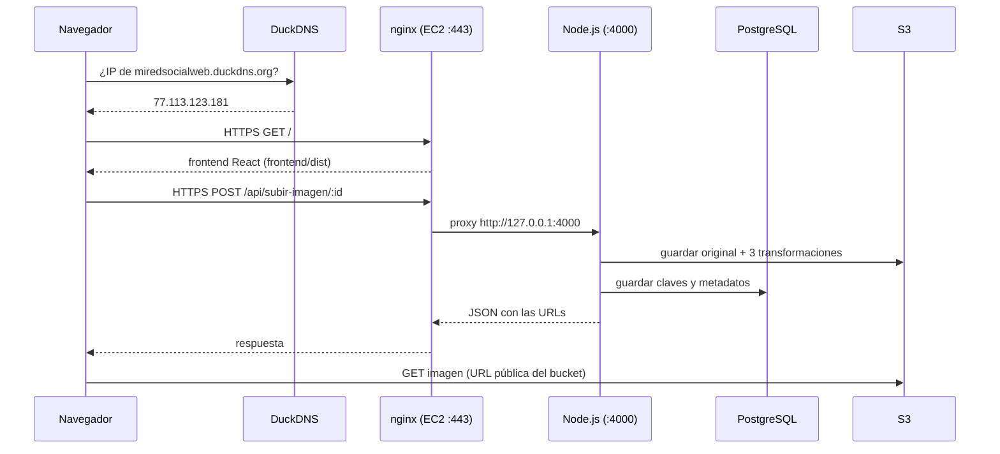
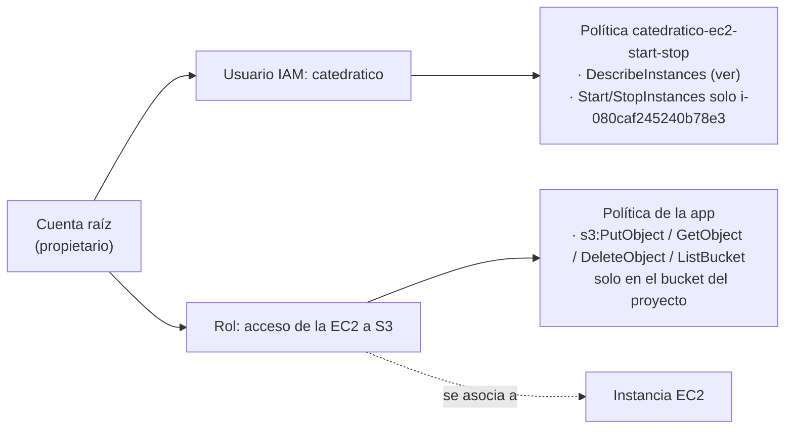
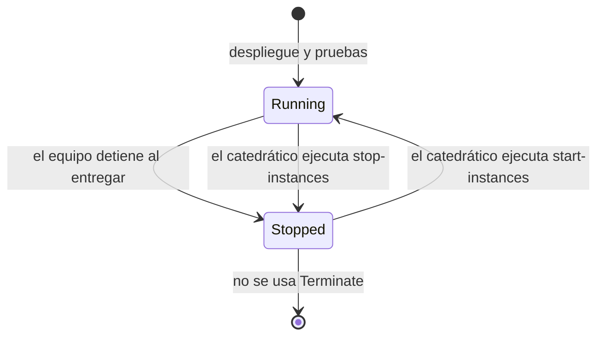

# Diagramas de Cloud Computing

Diagramas de la infraestructura en la nube usada para la entrega (AWS, región Ohio,
us-east-2).

## 1. Topología general

## 2. Flujo de una solicitud (del navegador al dato)

## 3. Identidad y permisos (IAM)

Principio aplicado: **mínimo privilegio**. El catedrático no puede crear ni borrar recursos, y
la aplicación no guarda claves de acceso en el servidor.

## 4. Ciclo de vida de la instancia para la revisión

Al estar detenida no se cobra la instancia; se conservan el disco (EBS), la base de datos y la
IP elástica asociada.

## 5. Recursos AWS usados

| Servicio | Recurso | Uso |
|---|---|---|
| EC2 | t3.micro, Ubuntu 24.04 | Aplicación completa |
| EC2 | Elastic IP | IP fija para el dominio |
| EC2 | Security Group | Firewall: 22, 80 y 443 |
| EC2 | Par de claves RSA | Acceso SSH |
| S3 | Bucket de imágenes | Almacén de las fotos |
| IAM | Rol de instancia + política S3 | Acceso a S3 sin claves |
| IAM | Usuario `catedratico` + política | Iniciar/detener la instancia |

## 6. Estimación de costo

Con el plan gratuito de la cuenta (créditos de $100 por 182 días) la entrega no genera cargo
directo. Fuera del plan, el consumo estimado es:

| Concepto | Observación |
|---|---|
| EC2 t3.micro | Se paga por hora encendida; detenida, no cobra cómputo. |
| EBS (disco) | Se cobra aunque la instancia esté detenida (pocos centavos al mes). |
| IPv4 pública / Elastic IP | AWS cobra por hora cada dirección IPv4 pública, esté asociada o no; con el crédito del plan gratuito no se paga. No liberarla mientras se revise el proyecto. |
| S3 | Centavos al mes con el volumen de pruebas. |
