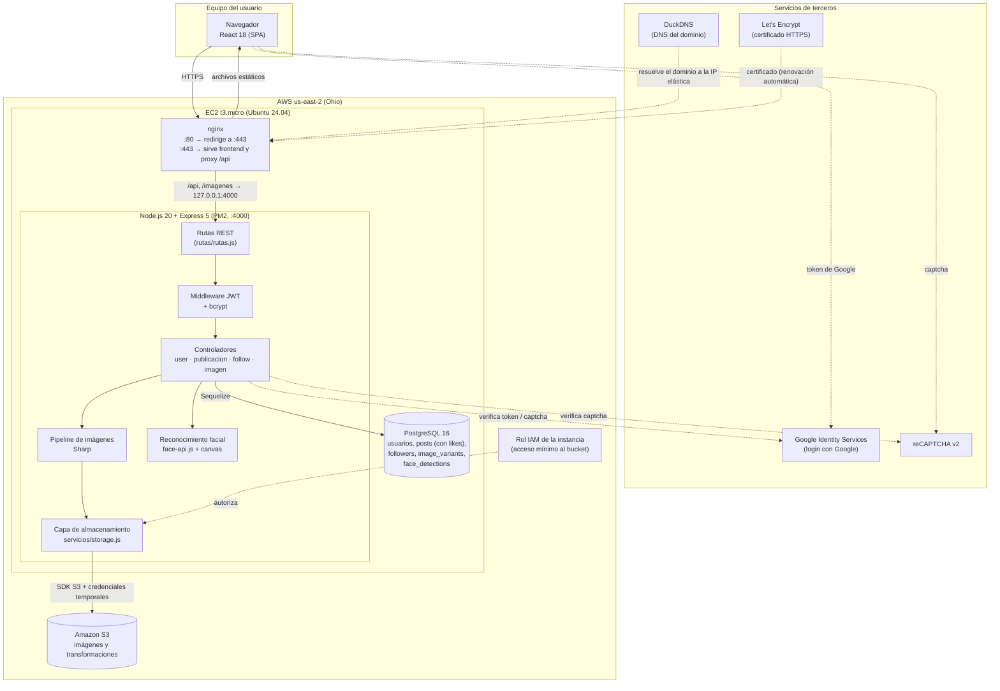

# Diagrama distribuido de componentes

Muestra los componentes de la solución, dónde se ejecuta cada uno y cómo se comunican.

## 1. Vista de componentes

## 2. Responsabilidad de cada componente

| Componente | Dónde corre | Responsabilidad |
|---|---|---|
| React (SPA) | Navegador | Interfaz, formularios, botón de Google, reCAPTCHA, galería y vista ampliada. |
| nginx | EC2 | Termina HTTPS, sirve `frontend/dist`, reenvía `/api` e `/imagenes` a Node. |
| Node.js / Express | EC2 (PM2) | API REST, autenticación, lógica de negocio. |
| Middleware JWT | Node | Valida el token en rutas protegidas. |
| Sharp | Node | Miniatura, blanco y negro, sepia y filtros manuales. |
| face-api.js + canvas | Node | Detección de rostros, edad y género. |
| storage.js | Node | Abstracción `local` / `s3`; el resto del código no conoce el destino. |
| PostgreSQL | EC2 | Cuentas, publicaciones, seguidores y el índice de imágenes (nunca el binario). |
| Amazon S3 | AWS | Archivos de imagen. |
| Rol IAM | AWS | Credenciales temporales de la instancia hacia S3, sin claves en el servidor. |
| DuckDNS / Let's Encrypt | Terceros | Nombre de dominio gratuito y certificado HTTPS. |

## 3. Qué es distribuido y qué no

- **Distribuido:** frontend (navegador), servidor de aplicación (EC2), almacenamiento (S3) y
  servicios externos (Google, reCAPTCHA, DNS).
- **Sin distribuir (decisión de costo):** nginx, Node y PostgreSQL comparten una instancia. En el
  plan de crecimiento de [`SEGMENTACION_RED.md`](SEGMENTACION_RED.md) se propone separarlos
  (base de datos en RDS en subred privada y balanceador de carga).
