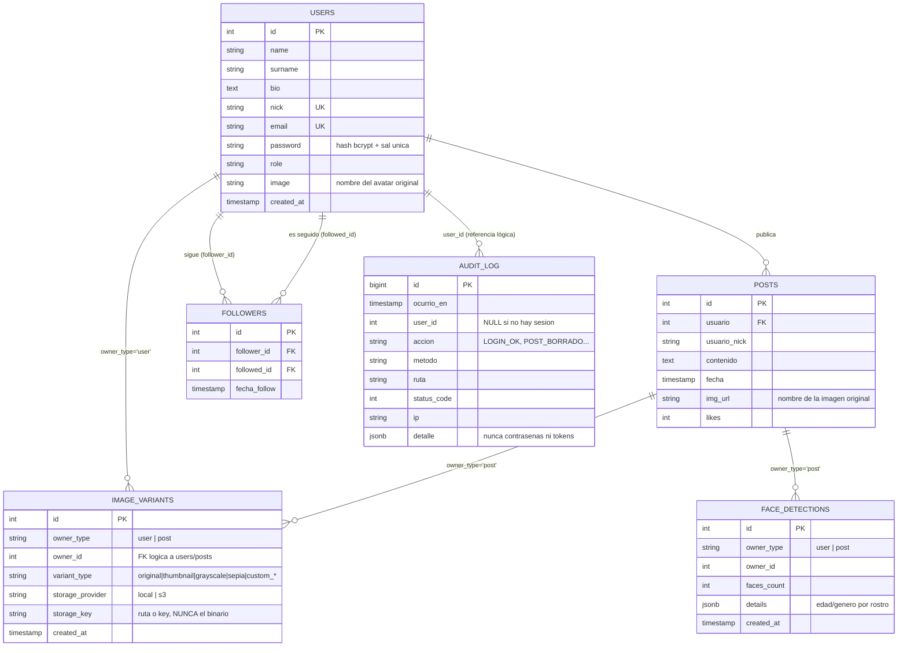

# Esquema de la base de datos (PostgreSQL)

Motor: **PostgreSQL 14+**. ORM: **Sequelize** (`modelo/*.js`). Esquema SQL de
referencia equivalente en [`database/schema.sql`](../database/schema.sql).

La app crea/actualiza las tablas automáticamente al arrancar
(`sequelize.sync()`, ver `database/conexion.js`). Para producción se recomienda
ejecutar `database/schema.sql` manualmente y desactivar el `sync` automático,
pero para la entrega académica el `sync` simplifica el primer arranque.

## Diagrama entidad-relación

## Notas de diseño

- **Las imágenes nunca se guardan en la base de datos.** `image_variants` y
  `face_detections` solo guardan metadatos y la referencia de almacenamiento
  (`storage_key`): una ruta relativa en disco (`post/xxxx.jpg`) o una *key* de S3,
  según `storage_provider`. El binario vive en disco o en S3; la BD solo sabe
  *dónde* está.
- `image_variants.owner_id` es una referencia **lógica** (no una FK física de
  PostgreSQL) porque puede apuntar a `users.id` o a `posts.id` según
  `owner_type`. Esto es un patrón polimórfico común cuando una tabla referencia
  a más de una tabla padre.
- `followers` tiene una restricción `UNIQUE(follower_id, followed_id)` y un
  `CHECK(follower_id <> followed_id)` para impedir seguirse a uno mismo o
  duplicar el seguimiento, a nivel de base de datos (no solo en el código).
- Los nombres de columnas usan `snake_case` (convención PostgreSQL) mientras que
  los modelos Sequelize exponen los atributos en `camelCase`
  (`usuarioNick`, `imgUrl`, etc.) para no romper el contrato ya usado por el
  frontend.

## Mantenimiento de la base de datos

- **Backups**: en RDS, habilitar *automated backups* (retención 7 días mínimo) y
  tomar un *snapshot* manual antes de cambios grandes de esquema. En una
  instalación nativa sobre la misma EC2 (como en `deploy/ec2-bootstrap.sh`), usar
  `pg_dump` programado (cron) hacia S3.
- **Migraciones futuras**: si el proyecto crece más allá de la entrega académica,
  reemplazar `sequelize.sync({ alter: true })` por migraciones versionadas
  (`sequelize-cli db:migrate`) para evitar cambios de esquema no controlados en
  producción.
- **Índices**: ya incluidos para las consultas más frecuentes del feed
  (`posts(usuario)`, `posts(fecha DESC)`, `image_variants(owner_type, owner_id)`).
