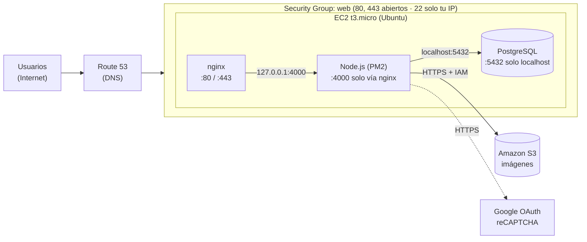
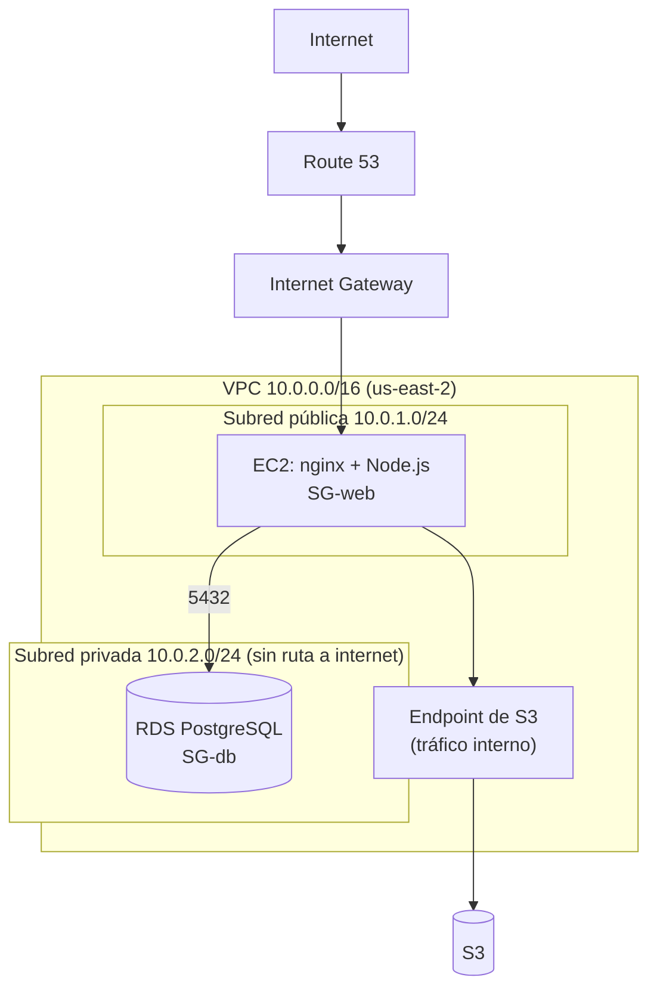

# Manual de segmentación de red

Proyecto Final de Desarrollo Web (UMG) — Red social de fotografías.

Describe cómo se separan los componentes en la red: primero la **arquitectura actual**
(una sola instancia EC2, la que pide el enunciado) y luego la **arquitectura recomendada**
para un entorno real.

## 1. Arquitectura actual (despliegue de la entrega)

Todo corre en una instancia **EC2 t3.micro** en Ohio (us-east-2), protegida por un Security
Group. La separación entre componentes es **lógica** (procesos y puertos), no física.



### Reglas del Security Group

| Dirección | Tipo | Puerto | Origen / destino | Motivo |
|---|---|---|---|---|
| Entrada | SSH | 22 | **Solo la IP del administrador** | Administración remota |
| Entrada | HTTP | 80 | 0.0.0.0/0 | Sitio web y desafío de Certbot |
| Entrada | HTTPS | 443 | 0.0.0.0/0 | Sitio web cifrado |
| Entrada | — | 4000 | **Cerrado** | La API solo se alcanza a través de nginx |
| Entrada | — | 5432 | **Cerrado** | PostgreSQL solo acepta conexiones locales |
| Salida | Todo | Todo | 0.0.0.0/0 | Paquetes, S3, Google |

### Cómo queda segmentado

| Segmento | Qué contiene | Quién puede llegar |
|---|---|---|
| Público | nginx (80/443) | Cualquier usuario de internet |
| Aplicación | Node.js en el puerto 4000 | Solo nginx, por `127.0.0.1` |
| Datos | PostgreSQL en el puerto 5432 | Solo la app, por `localhost` |
| Almacenamiento | Bucket S3 | La app, con una llave IAM de mínimo privilegio; lectura pública solo de las fotos |
| Administración | SSH | Solo la IP del administrador |

## 2. Firewall del servidor (refuerzo opcional)

Además del Security Group, se puede activar el firewall del propio Ubuntu. **Permitir SSH
antes de activarlo** o se pierde el acceso:

```bash
sudo ufw default deny incoming
sudo ufw default allow outgoing
sudo ufw allow from <TU_IP> to any port 22 proto tcp
sudo ufw allow 80/tcp
sudo ufw allow 443/tcp
sudo ufw enable
sudo ufw status verbose
```

## 3. Arquitectura recomendada para producción

La mejora principal es **sacar la base de datos de la instancia web** y ponerla en una
subred privada, sin ruta a internet.



| Grupo | Entrada permitida | Salida |
|---|---|---|
| **SG-web** | 80 y 443 desde internet · 22 solo desde la IP del administrador | Todo |
| **SG-db** | 5432 **únicamente desde SG-web** | Ninguna necesaria |

Mejoras adicionales:

- **Acceso administrativo sin SSH abierto**: usar AWS Systems Manager Session Manager.
- **Listas de control de red (NACL)** en la subred privada: denegar todo lo que no venga de la subred pública.
- **Endpoint de S3 (gateway)**: el tráfico a S3 no sale a internet.
- **AWS WAF** delante de nginx si la aplicación se vuelve pública de verdad.
- **HTTPS obligatorio**: Certbot con redirección de 80 a 443.

## 4. Cómo verificar la segmentación

Desde **otra máquina** (no desde la instancia):

```bash
nmap -Pn -p 22,80,443,4000,5432 <IP-publica-EC2>
```

Resultado esperado: 80 y 443 abiertos; 4000 y 5432 **filtrados/cerrados**; 22 abierto solo
si se prueba desde la IP autorizada.

Desde la instancia:

```bash
sudo ss -tlnp | grep -E ':(80|443|4000|5432)\s'
```

Esperado: nginx en `0.0.0.0:80`, PostgreSQL en `127.0.0.1:5432`. Node escucha en el
puerto 4000, pero el Security Group lo bloquea desde fuera.
